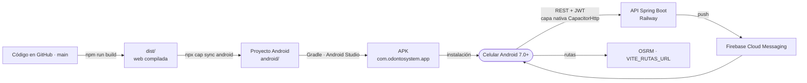

# Documentación de Despliegue — App móvil de OdontoSystem (Android)

App para pacientes y odontólogos construida con **React 18 + Vite 5** y empaquetada para Android con **Capacitor 8**.
Repositorio: `Nickssssss-del/APPFRONTENDODONTO` · Identificador: `com.odontosystem.app` · Responsable: Nicole De La Cruz.
La API y su despliegue están documentados en el repositorio del backend ([DESPLIEGUE.md](https://github.com/Luaaa7/OdontoSystem/blob/main/docs/DESPLIEGUE.md)).

## 1. Arquitectura del sistema y entornos

### Diagrama de arquitectura de despliegue



La app es la versión web compilada dentro de un WebView de Android. Las llamadas a la API salen por la capa nativa
(`CapacitorHttp`, `capacitor.config.ts`) y no por el WebView, para evitar el bloqueo de CORS del origen `https://localhost`.
El token de actualización se guarda cifrado en el almacenamiento seguro de Android (`@aparajita/capacitor-secure-storage`).

### Entornos disponibles

| Entorno | Dónde | Para qué |
|---|---|---|
| **Desarrollo web** | PC, `npm run dev` en el navegador | Programar las pantallas con recarga en caliente. Los plugins nativos (push, almacenamiento seguro, Google) no funcionan aquí. |
| **Depuración en Android** | APK *debug* instalado en un celular o emulador | Probar la app real con la API de producción. |
| **Producción** | APK *release* firmado, instalado en los celulares de los usuarios | Uso real. La app no está publicada en Google Play: se distribuye el archivo APK. |

## 2. Requisitos previos

| Elemento | Versión |
|---|---|
| Node.js / npm | Node 22 LTS (`package-lock.json` en el repositorio) |
| JDK | 21 (lo exige Capacitor 8: `capacitor.build.gradle` compila con Java 21) |
| Android Studio | Versión reciente, con Android SDK Platform 36 |
| Gradle / Android Gradle Plugin | 8.14.3 / 8.13.0 (los trae el proyecto; no hay que instalarlos) |
| SDK de Android | `minSdk` 24 (Android 7.0) · `compileSdk` y `targetSdk` 36 (`android/variables.gradle`) |
| Firebase | Proyecto con Cloud Messaging y el archivo `android/app/google-services.json` |
| Backend | API de OdontoSystem en Railway |

## 3. Variables de entorno

Las variables `VITE_` se **incrustan en la app al compilar** (`npm run build`): son públicas y nunca deben contener
secretos. Van en un archivo `.env` en la raíz (está en `.gitignore`); la plantilla es [`.env.example`](../.env.example).
**Si cambia una variable hay que volver a compilar, sincronizar y generar el APK.**

| Variable | Obligatoria | Descripción | Valor de producción |
|---|---|---|---|
| `VITE_API_URL` | Sí | URL base de la API | `https://odontosystem-production.up.railway.app` |
| `VITE_GOOGLE_CLIENT_ID` | Sí, para «Continuar con Google» | Client ID OAuth **de tipo Web** (el mismo que `GOOGLE_CLIENT_ID` del backend). En Android el plugin lo usa como *server client id*. Nunca el cliente Android ni un *client secret*. | `<id>.apps.googleusercontent.com` |
| `VITE_PUSH_ENABLED` | No | Activa las notificaciones push. Debe ser `true` solo si existe `android/app/google-services.json`: sin él, `PushNotifications.register()` cierra la app (`src/lib/push.ts`). | `true` |
| `VITE_RUTAS_URL` | No | Servidor OSRM para dibujar rutas. Si falta, usa el público `https://router.project-osrm.org` (`src/lib/rutas.ts`). | *(vacío)* |

Archivos que no son variables pero condicionan la compilación:

- `android/app/google-services.json` (Firebase). Si no existe, Gradle no aplica el plugin de Google Services y el push no
  funciona (`android/app/build.gradle`). El archivo está en el repositorio: sus claves son de cliente y, desde el 19/11/2026,
  la clave «Android key (auto created by Firebase)» está **restringida en Google Cloud → APIs y servicios → Credenciales** a
  *Apps para Android*: paquete `com.odontosystem.app` con la huella SHA-1 del certificado de depuración
  (`9C:F4:C3:50:98:92:32:D4:9B:AC:D0:…`). Cualquier otra app que use la clave queda rechazada.
- El *keystore* de firma de release (sección 4, paso C). **Nunca se sube al repositorio.**

## 4. Paso a paso del despliegue

### A — Preparar el proyecto

```bash
git clone https://github.com/Nickssssss-del/APPFRONTENDODONTO.git
cd APPFRONTENDODONTO
npm ci
cp .env.example .env          # completar VITE_GOOGLE_CLIENT_ID
npm run typecheck && npm run lint && npm run test
```

### B — Generar el APK de depuración (pruebas)

```bash
npm run build                 # compila la web en dist/
npx cap sync android          # copia dist/ a android/app/src/main/assets/public y actualiza los plugins
npx cap open android          # abre el proyecto en Android Studio
```

En Android Studio: **Build → Build App Bundle(s) / APK(s) → Build APK(s)**. También desde la terminal:

```bash
cd android
./gradlew assembleDebug       # en Windows: gradlew.bat assembleDebug
```

Resultado: `android/app/build/outputs/apk/debug/app-debug.apk`.

> **Importante:** `npx cap sync android` es obligatorio después de cada `npm run build`. Sin él, el APK lleva la versión
> web anterior aunque el código haya cambiado.

### C — Generar el APK de release firmado (producción)

1. Subir la versión en `android/app/build.gradle`: `versionCode` (entero, +1 en cada entrega) y `versionName` (por ejemplo `1.1`).
2. `npm run build` y `npx cap sync android`.
3. Android Studio → **Build → Generate Signed App Bundle / APK → APK**.
4. Crear o elegir el *keystore* (`odontosystem-release.jks`), con su contraseña y su *alias*. Guardarlo fuera del repositorio
   y en un lugar seguro: **si se pierde, no se pueden publicar actualizaciones de la misma app**.
5. Variante **release** → resultado en `android/app/build/outputs/apk/release/app-release.apk`.
6. Obtener la huella SHA-1 del keystore de release y **agregarla** a la restricción de la clave de Firebase (Google Cloud →
   Credenciales → «Android key» → Apps para Android → Add). Si falta, el APK de release no podrá registrarse para push.

**Cómo obtener una huella SHA-1** (desde la carpeta `android`, en PowerShell):

```powershell
.\gradlew.bat signingReport          # bloque «Variant: debug» o «release» → línea SHA1
# si falla por JAVA_HOME:
$env:JAVA_HOME = "C:\Program Files\Android\Android Studio\jbr"
```

### D — Instalar en un celular

- Por cable: activar *Depuración USB* en el celular y ejecutar `adb install -r app-release.apk` (`-r` reemplaza la versión
  instalada y conserva los datos).
- Sin cable: enviar el APK al celular, abrirlo y permitir «Instalar apps de origen desconocido».
- Al abrir la app por primera vez debe pedir permiso de notificaciones (Android 13+) y de ubicación al usar el mapa.

## 5. Integración continua y despliegue continuo (CI/CD)

| Paso | Dónde | Estado |
|---|---|---|
| Tipos, lint, pruebas (Vitest) y build web | GitHub Actions (`.github/workflows/ci.yml`), en cada PR y en cada push a `main` | Activo, con Node 22 |
| Integración a `main` | Pull request en GitHub, con la CI en verde | Activo |
| Generación y distribución del APK | Manual (sección 4) | Activo |
| Seguridad de dependencias | `npm audit` (manual) | Evidencias en el backend: `docs/seguridad/evidencias/npm-audit-app-*.txt` |

## 6. Monitoreo, verificación y rollback

- **Prueba de humo** con cada APK nuevo, en un Android real:
  1. Iniciar sesión como paciente y como odontólogo, también con Google.
  2. Abrir la agenda del odontólogo, el catálogo con el mapa y «Mis citas».
  3. Confirmar que llega una notificación push con la app en segundo plano.
  4. Activar el modo avión: «Mis citas» debe mostrar las citas guardadas y el aviso «Sin conexión».
- **Monitoreo:** la app no tiene monitoreo propio; sus problemas se ven del lado de la API (Grafana Cloud, UptimeRobot y logs de
  Railway; ver `docs/MONITOREO.md` del backend). La entrega de push se revisa en **Firebase console → Messaging**.
- **Logs de la app:** con el celular conectado, Android Studio → **Logcat** (filtrar por `com.odontosystem.app`), o
  `chrome://inspect` en Chrome de la PC para ver la consola del WebView.
- **Plan de retorno (rollback):**
  1. Guardar cada APK entregado con su versión (por ejemplo `OdontoSystem-1.1.apk`).
  2. Si una versión falla, reinstalar el APK anterior. Si tiene un `versionCode` menor, primero desinstalar la app (`adb uninstall
     com.odontosystem.app`) y luego instalar (`adb install`).
  3. Corregir en una rama, abrir PR, fusionar y generar un APK nuevo con un `versionCode` mayor.
  4. La app no tiene base de datos propia (solo una copia sin conexión de las citas), así que el rollback no afecta datos del
     servidor.

## 7. Pendientes conocidos

- Configurar la firma de release (sección 4.C) y guardar el *keystore* fuera del repositorio. El APK de release actual
  (`app-release-unsigned.apk`) no está firmado.
- Subir `versionCode`/`versionName` en cada entrega (hoy `1` / `1.0`).
- Al firmar el release, agregar su huella SHA-1 a la restricción de la clave de Firebase (sección 4.C, paso 6).
