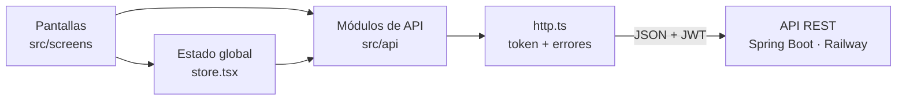
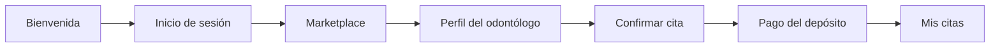

<div align="center">

# OdontoSystem · App móvil

**Aplicación móvil del marketplace dental OdontoSystem para pacientes y odontólogos de Ica**


[Backend (API)](https://github.com/Luaaa7/OdontoSystem) · [Portal web](https://github.com/Nickssssss-del/Frontend_OdontoSystem)

</div>

---

## Descripción

App con diseño móvil (*mobile-first*) que lleva al celular las funciones principales de OdontoSystem. Es la **Vista** del patrón MVC: consume la misma API REST que el portal web, de modo que una cita reservada en la app aparece al instante en la web y viceversa.

| Paciente | Odontólogo |
|---|---|
| Recorrido de bienvenida, registro e inicio de sesión (también con Google) | Panel con citas del día e indicadores |
| Marketplace de odontólogos por distrito y especialidad | Agenda para confirmar, completar o marcar inasistencias |
| Perfil del odontólogo, servicios y reseñas | Lista de pacientes y detalle de cada atención |
| Reserva, pago del depósito y comprobantes | Perfil profesional |
| Mis citas, notificaciones, reputación y chatbot | |

## Arquitectura



La comunicación con el backend está separada por dominio en `src/api`:

| Módulo | Responsabilidad |
|---|---|
| `http.ts` | Cliente base: URL de la API, token `Bearer` y manejo uniforme de errores |
| `auth.ts` | Registro, inicio de sesión, Google y cierre de sesión |
| `catalog.ts` | Odontólogos, especialidades, distritos y disponibilidad |
| `citas.ts` | Reserva, pago, cancelación, constancias y reseñas |
| `panel.ts` | Agenda e indicadores del odontólogo |
| `usuarios.ts` | Perfil, foto y reputación del paciente |
| `chatbot.ts` | Mensajes con el asistente |
| `archivos.ts` | Subida de imágenes |

## Pantallas

| Flujo | Pantallas (`src/screens`) |
|---|---|
| Inicio | `SplashScreen`, `WelcomeSplash`, `WelcomeTutorial`, `Onboarding` |
| Búsqueda y reserva | `Marketplace`, `DentistProfile`, `ConfirmarCita`, `checkout/` |
| Paciente | `PatientDashboard`, `PatientAppointments`, `PatientNotifications`, `PatientProfile`, `patientProfile/` |
| Odontólogo | `dentist/Dashboard`, `dentist/Agenda`, `dentist/Patients`, `dentist/PatientDetail`, `dentist/Profile` |
| Asistente | `Chatbot` |
| Soporte | `DiagnosticoConexion` (prueba la conexión con la API) |



## Tecnologías

| Uso | Librería |
|---|---|
| Interfaz | React 18, TypeScript, Tailwind CSS 3 |
| Animaciones | Framer Motion |
| Íconos | Lucide |
| Compilación | Vite 5 |
| Android | Capacitor (siguiente paso: empaquetar la app para Google Play) |

## Cómo ejecutarlo

```bash
npm install
npm run dev      # http://localhost:5173 (abrir en modo móvil del navegador)
npm run build    # versión de producción
```

## Equipo y flujo de trabajo

Desarrollada por **Nicole De La Cruz Chávez** (diseño UX/UI y desarrollo). El proyecto partió de una plantilla de Vite + React generada con Bolt.
Cada cambio se trabaja en una rama `nicole/…` y se integra a `main` mediante pull request.
